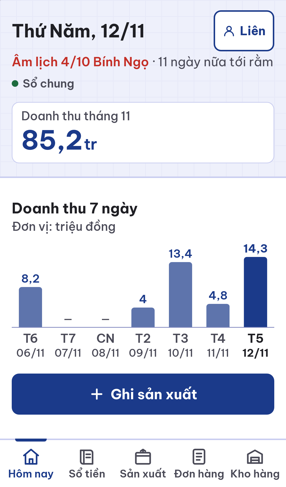
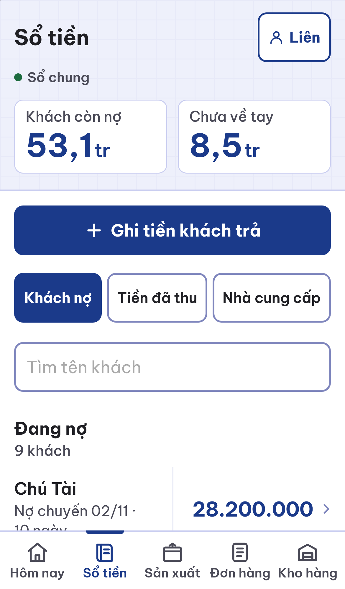
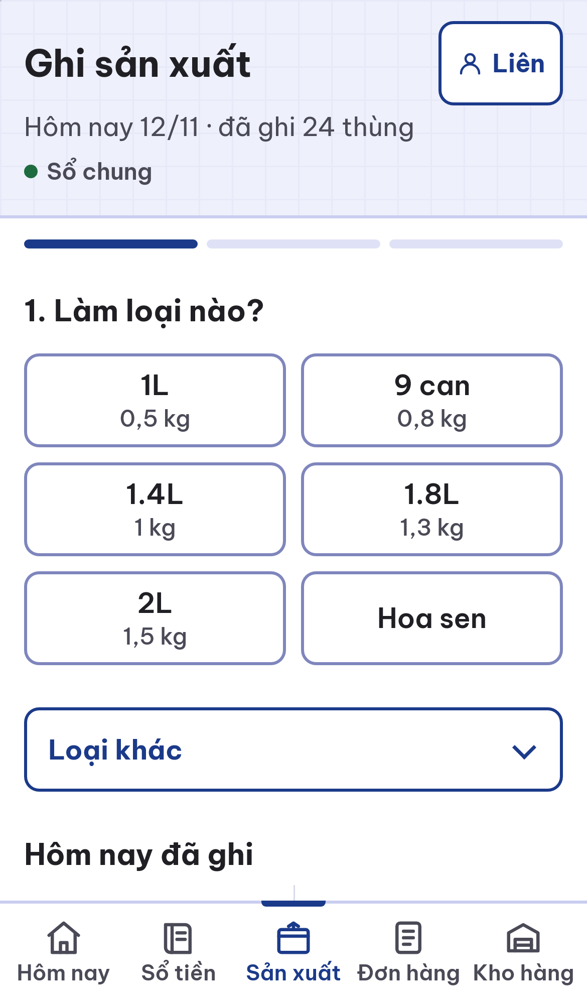
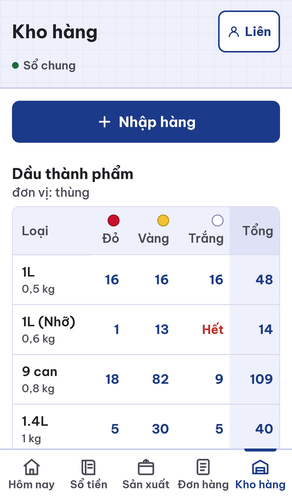
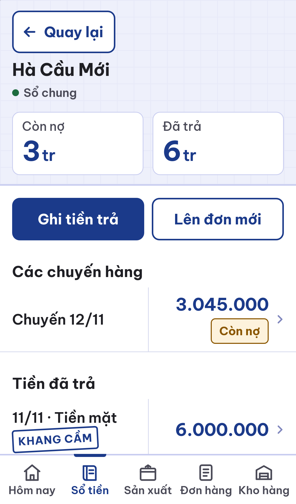
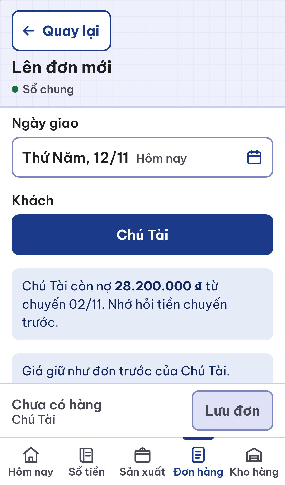
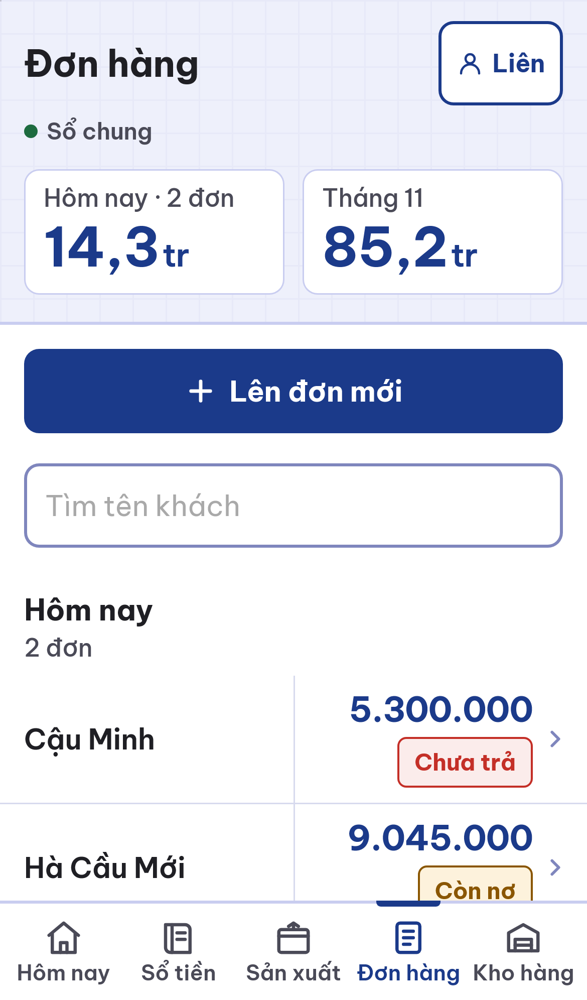
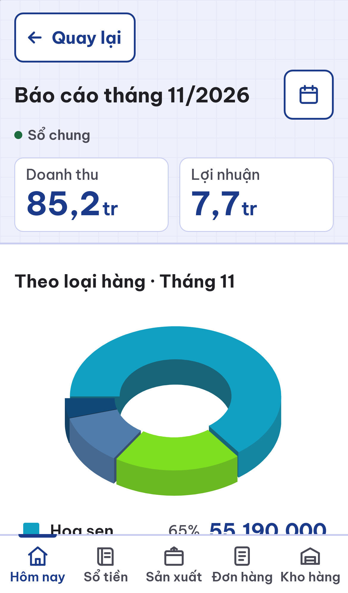

# Sổ công dầu

A shared ledger app for a small family workshop that makes lamp oil and candles in Vietnam. It replaces a fragile Excel sheet with an installable phone app the whole family uses: what is in stock, who owes money, how much was produced today, and what to reorder.

The interface is in Vietnamese and is designed for older users on phones: large text, one main action per screen, and Vietnamese search without diacritics ("cau minh" finds "Cậu Minh").

> The data in this repository is demo data. Customer and supplier names are made up.

<p>
  
  
  
  
</p>
<p>
  
  
  
  
</p>

**[Read the user guide](docs/USER-GUIDE.md)** for a walk through every screen.

## What it does

- **Hôm nay (Today):** the owner's four daily answers on one screen: stock, money owed, oil tanks left, and materials to reorder, plus a monthly revenue chart.
- **Sổ tiền (Money book):** every customer payment is tracked by method (cash or bank transfer), by who is holding it, and by whether it has reached the owner. Customer debts are worked out per trip, with search across customers.
- **Sản xuất (Production):** a quick daily production log. Oil tanks used are estimated from the cartons produced.
- **Đơn hàng (Orders):** new orders keep each customer's last price, and orders are grouped into bills per trip.
- **Kho hàng (Stock):** finished goods per size and colour, and raw materials deducted through a bill of materials.
- **Accounts:** each family member signs in with their name and a 6-digit PIN. The owner can delete mistaken bills, and every entry records who wrote it.
- **Works offline:** entries are saved on the phone and sync when the connection comes back (weak wifi in the workshop).
- **Lunar calendar:** dates also show the Vietnamese lunar date.

## Tech

- Plain HTML, CSS and JavaScript, installable as a PWA (service worker and web app manifest), with no front-end framework
- Firebase Authentication and Cloud Firestore with offline persistence, bundled with esbuild (`src/backend.js` is the only file that talks to Firebase)
- Firestore security rules decide who can read and write what, and they have their own test suite
- Firebase Hosting
- Node.js admin scripts to manage accounts, plus a Python script that converts the old Excel sheet into ledger rows

## Try it locally

You need Node.js 20 or later and Java 21 or later (for the Firebase emulators). Everything runs on your machine against a demo emulator project, so no Firebase account is needed.

```bash
npm install
npm run demo
```

When the terminal says **All emulators ready**, open a second terminal in the same folder and load the demo book:

```bash
npm run demo:load
```

Then open http://127.0.0.1:5000 and sign in:

| Name | PIN | Role |
|---|---|---|
| Liên | `264803` | Owner: sees everything, including revenue and profit |
| Khang, Ngân, Dũng | `917452` | Workers |

The demo dates move with the calendar, so the latest orders and production always land on today. Run `npm run demo:load` again at any time to reset the demo. Stop the emulators with Ctrl+C.

For the best view, open your browser's device toolbar and pick a phone size: the app is designed for phones.

## Tests

- **Vitest** against the Firebase emulators: security rules, the backend wrapper, account tools and the data import
- **Playwright** end-to-end tests on an emulated iPhone 13: sign-in, entering orders, payments and production, search, and offline behaviour

```bash
npm install
npm run build
npm run test:rules
npm run test:unit
npm run test:e2e
```

The tests need Java for the Firebase emulators. Running locally always connects to a demo emulator project, never to real data.

## Project layout

```
app/        the web app (index.html, app.js, styles.css, service worker, fonts, icons)
src/        Firebase wrapper, bundled into app/backend.js
admin/      account and data-import scripts
scripts/    loads the demo book into the local emulators
tests/      Vitest and Playwright tests
docs/       user guide, screenshots and Firebase setup guide
DESIGN.md   design system: colours, type, components and the rules behind them
```

## How it was built

I started by interviewing the family about how they actually use the spreadsheet: what gets forgotten, what causes arguments, and what they keep phoning each other to ask. The screens came from those answers, then went through an accessibility check and several rounds of changes based on the family's feedback.
