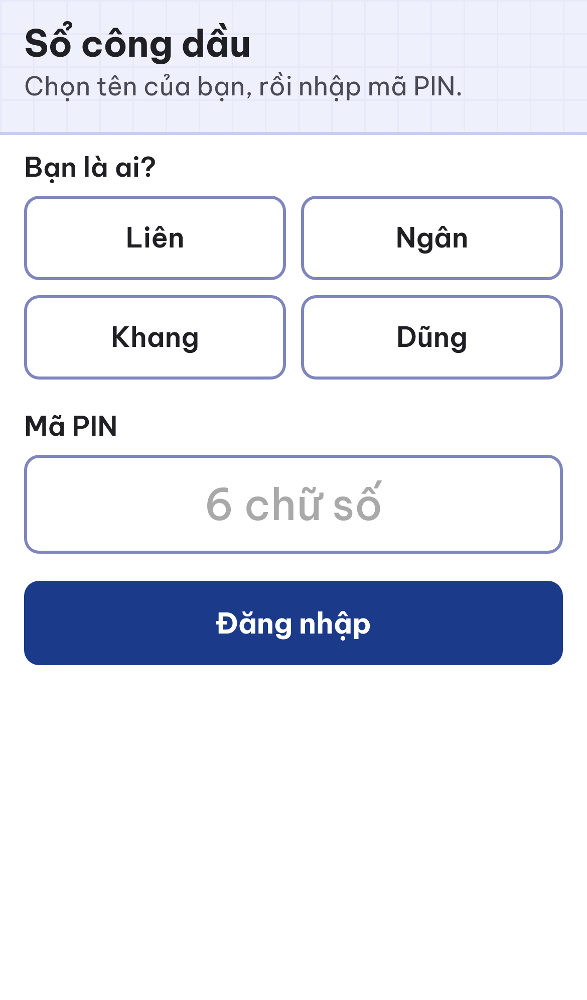
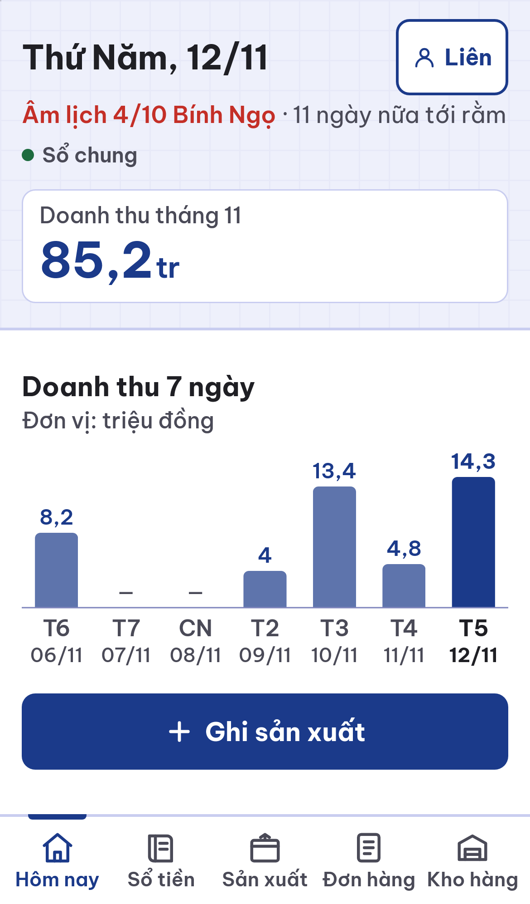
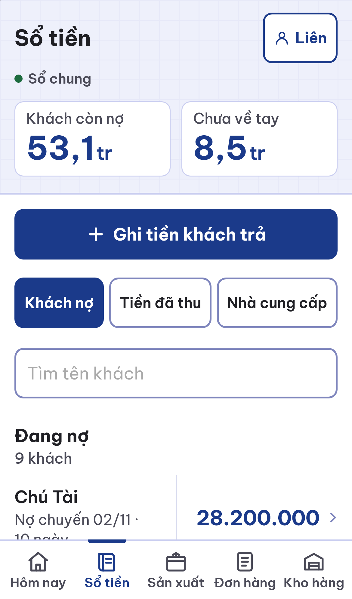
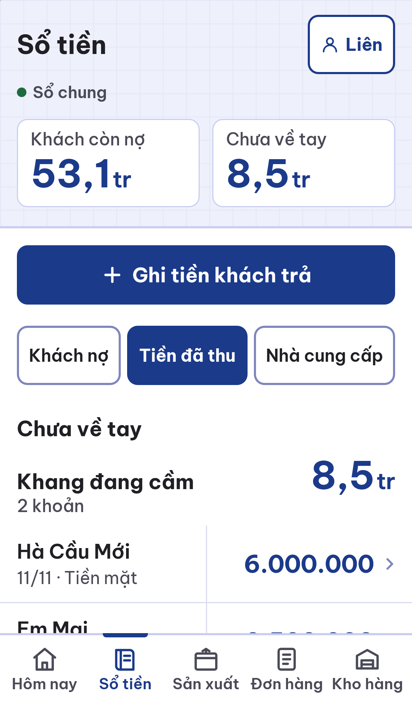
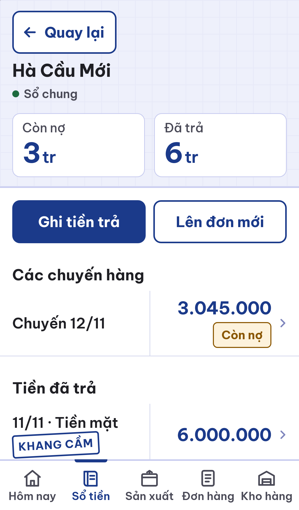
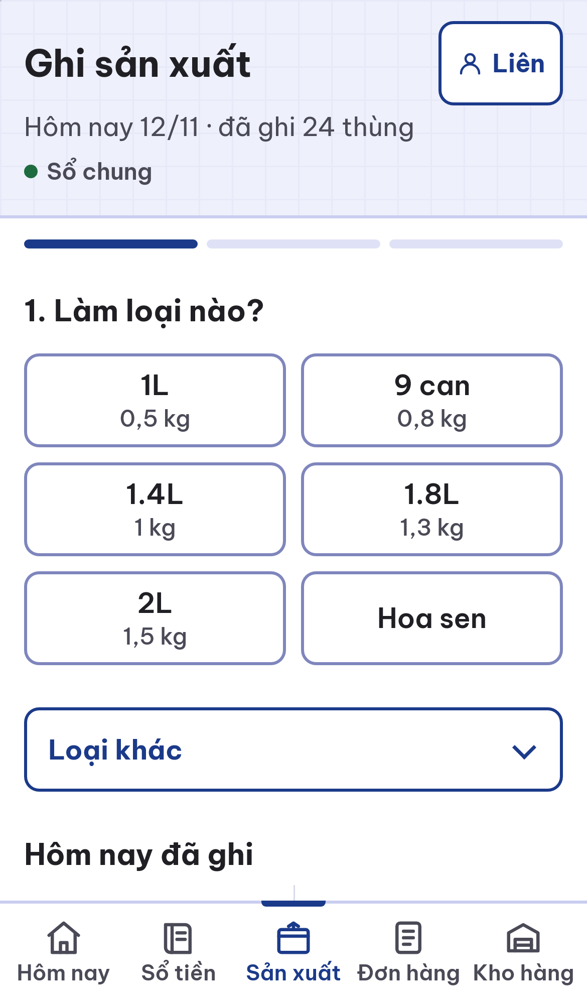
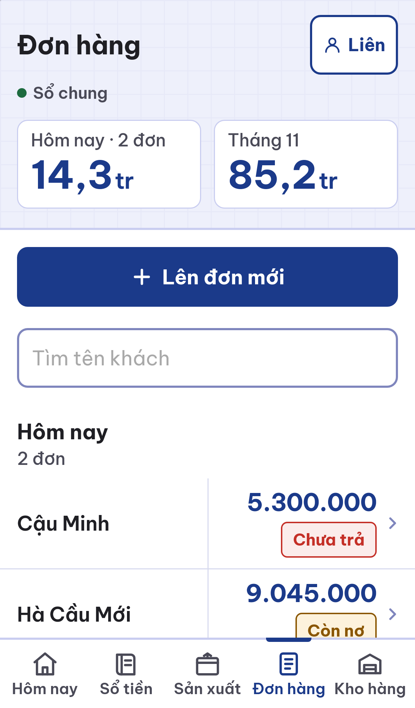
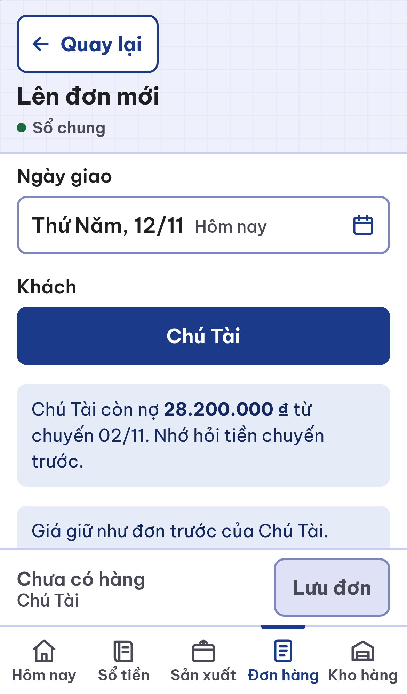
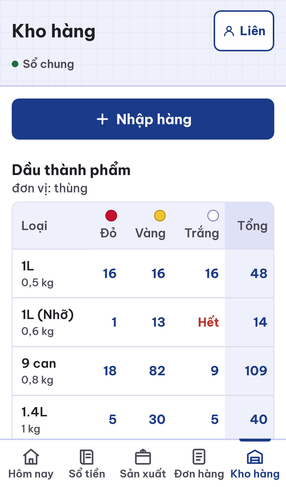
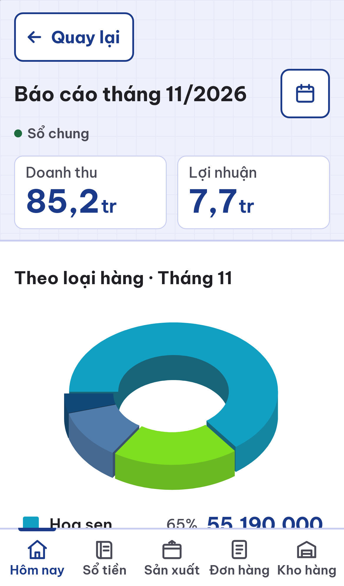

# User guide

How the family uses Sổ công dầu day to day. The app is in Vietnamese; each section gives the Vietnamese labels in **bold** with an English meaning, so you can follow along in the demo.

The screenshots use the demo data (made-up customers) on an iPhone-sized screen. To open the same demo yourself, see [Try it locally](../README.md#try-it-locally).

## Who uses it

- **The owner** (Liên) takes the money, makes the decisions and sees everything: revenue, profit and every customer's debt.
- **Workers** (the producer and anyone who delivers) log production, take orders and record cash they collect. They don't see revenue or profit.

Everyone shares one book. An entry written on one phone shows up on the others within a second or two, and every entry records who wrote it.

## 1. Sign in

1. Tap your name under **Bạn là ai?** (Who are you?).
2. Type your 6-digit **Mã PIN**.
3. Tap **Đăng nhập** (Sign in).

The phone stays signed in, so this is a one-time step. In the demo, the owner's PIN is `264803` and every worker's is `917452`.

 

## 2. Hôm nay — Today

The home screen answers the owner's daily questions without having to ask anyone:

- Today's date and the **Âm lịch** (lunar date), with the days left until the full moon.
- **Doanh thu tháng** (revenue this month) and a 7-day revenue chart. Tap the total to open the monthly report.
- The **Ghi sản xuất** (Log production) button.
- Below it, the things that need attention, such as money not yet handed to the owner and **Vật tư cần đặt** (materials to reorder).

The green dot labelled **Sổ chung** (shared book) means the phone is online and in sync.

 

## 3. Sổ tiền — Money book

The top cards show **Khách còn nợ** (what customers owe in total) and **Chưa về tay** (money collected that hasn't reached the owner yet).

Three tabs:

- **Khách nợ**: customers who owe, the oldest debt first, with the trip it dates from. Use **Tìm tên khách** to search; you can type without Vietnamese accents.
- **Tiền đã thu**: money received, grouped by who is holding it.
- **Nhà cung cấp**: what the workshop owes its suppliers.

**To record a payment:** tap **Ghi tiền khách trả**, pick the customer, type the amount, choose **Tiền mặt** (cash) or **Chuyển khoản** (bank transfer), and tap **Lưu** (Save). A payment goes to the customer's oldest unpaid trip first.

 

### Following the money to the owner

The family's biggest source of arguments was not knowing who was holding a customer's payment. So every payment records **who holds it** and **whether it has reached the owner**.

When a worker collects cash on a delivery, it appears under **Chưa về tay** as "*name* đang cầm" (*name* is holding it). When the worker hands it over, the owner taps the line and confirms she received it. It then moves out of the list.

 

## 4. A customer's page

Tap any customer to see:

- **Còn nợ** (still owed) and **Đã trả** (paid so far).
- **Các chuyến hàng**: each delivery trip, marked **Đã trả** (paid), **Còn nợ** (partly paid) or **Chưa trả** (unpaid). Tap a trip to see its bill.
- **Tiền đã trả**: each payment, stamped with who is holding the cash.

Buttons at the top record a payment or start a new order for this customer.

 

## 5. Sản xuất — Production

Logging the day's production takes three taps, so the producer can do it at the end of a tiring day:

1. **Làm loại nào?** Pick the product (can size). Less common ones are under **Loại khác**.
2. Pick the colour: **Đỏ** (red), **Vàng** (yellow) or **Trắng** (white).
3. Set the number of **thùng** (cartons) with the + and − buttons, then save.

**Hôm nay đã ghi** lists what has been logged today. **Xem sổ các ngày trước** opens earlier days. Stock goes up and materials (cans, labels, cartons) go down automatically.

 

## 6. Đơn hàng — Orders

The top cards show today's and this month's sales. Orders are grouped into bills, one per customer per day, each with its paid status. Search by customer name, or tap a bill to see its lines.

 

### Taking a new order

1. Tap **Lên đơn mới** (New order).
2. Check **Ngày giao** (delivery date). It defaults to today.
3. Pick the **Khách** (customer). If they still owe for an earlier trip, the app shows a reminder to ask for that money.
4. Add the products and carton counts. Prices start at what this customer paid last time.
5. Tap **Lưu đơn** (Save order). The order is saved as delivered, so stock goes down and the customer's debt goes up straight away.

 

## 7. Kho hàng — Stock

- **Dầu thành phẩm**: finished oil, in cartons, for each size and colour. **Hết** in red means out of stock.
- Candles and raw materials (cans, labels, cartons) are further down, with **Vật tư cần đặt** (materials to reorder) at the top of the materials list.
- Stock is worked out from opening stock + production − deliveries − losses, never typed in by hand.

**Nhập hàng** records materials bought from suppliers, a new oil delivery, or damaged goods.

 

## 8. Báo cáo tháng — Monthly report

The owner's report for one month: **Doanh thu** (revenue), **Lợi nhuận** (profit, using the cost of each oil batch) and sales by product. The calendar button switches to another month.

Only the owner can open this page.

 

## When the connection drops

The workshop's wifi is weak upstairs. Entries made offline are kept on the phone and sent automatically when the connection comes back. Until then, the green **Sổ chung** line changes to **Chưa có mạng · N dòng chờ gửi** (no connection, N lines waiting to be sent).
